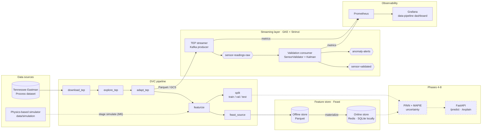

# ReactorGuard

**Cloud-native anomaly detection platform for nuclear reactors.**

ReactorGuard ingests real-time sensor streams from nuclear reactor instrumentation,
applies physics-informed machine learning to detect anomalies, and surfaces safety
alerts with uncertainty-quantified predictions. The platform is built for regulatory
auditability and operates on Google Kubernetes Engine.

## Highlights

- **Streaming pipeline**: Kafka producer/consumer services that validate every sensor reading
  (stuck, noise-spike, drift and Kalman-residual detectors) and publish alerts to a dedicated topic.
- **Reproducible data**: DVC pipeline from the Tennessee Eastman Process dataset to features,
  Feast offline/online stores and leak-free, time-ordered train/val/test splits, with identical hashes on rebuild.
- **Physics-based simulation**: ODE reactor model calibrated at equilibrium, energy and mass
  conservation checks, and eight fault types with severity labels.
- **Infrastructure as code**: Terraform modules (VPC, GKE, Kafka, IAM, security, storage) and Kustomize overlays.
- **Quality gates**: ruff, mypy strict, ~2,800 tests with coverage above 99 %, and a
  verification script that never reports an unmeasured criterion as met.

---

## Project status

Phase 2 (data pipeline) is code-complete and verified locally; no cloud infrastructure
has been deployed yet. Of its four success criteria, two are met (stuck-sensor precision,
DVC reproducibility) and two are **not measured** until they run on the cluster
(Kafka throughput, feature latency under load). See
[Docs/ReactorGuard_Progreso.md](Docs/ReactorGuard_Progreso.md) for the verified per-task status,
[Docs/ReactorGuard_Fase2_Streaming.md](Docs/ReactorGuard_Fase2_Streaming.md) for the streaming
design and runbook, and [Docs/Despliegue_GCP.md](Docs/Despliegue_GCP.md) for the deployment steps.

| Phase | Status |
|-------|--------|
| 1. GKE + Kafka | Code complete, not deployed |
| 2. Data pipeline + sensor validator | Code complete and verified locally: TEP streamer, validation consumer, features, Feast, storage client, DVC pipeline and dashboard. Criteria 1 and 3 need the cluster |
| 3. Physics-based simulation | In progress: thermal-hydraulic ODE model, physics constraints, process and instrument fault generation done (milestones M1-M5); DVC `simulate` stage and safety suite pending |
| 4-8. PINN, uncertainty, API, CI/CD, observability | Not started (scaffolding only) |

---

## Overview

| Component | Technology |
|-----------|------------|
| Stream ingestion | Apache Kafka (Strimzi on GKE) |
| ML model | Physics-Informed Neural Network (PyTorch) |
| Uncertainty quantification | MAPIE (conformal prediction) |
| Feature store | Feast (parquet offline; Redis online in the cluster, SQLite locally) |
| Experiment tracking | MLflow |
| API | FastAPI + OpenTelemetry |
| Infrastructure | GKE + Terraform |
| Observability | Prometheus + Grafana + Alertmanager |

---

## Prerequisites

| Tool | Version | Purpose |
|------|---------|---------|
| Python | 3.11+ (development venv uses 3.12) | Runtime |
| Terraform | ≥ 1.6.0 | Infrastructure provisioning |
| kubectl | ≥ 1.28 | Kubernetes management |
| Helm | ≥ 3.14 | Kubernetes package manager |
| gcloud CLI | latest | GCP authentication |
| Docker | ≥ 24 | Container build |
| DVC | ≥ 3.49 | Data versioning |

GCP access requirements:
- Project: `sentinel-platform-485714`
- Role: `Owner` (or a custom role with `container.admin`, `storage.admin`, `iam.admin`)
- Billing account linked

---

## Quick Start

### 1. Bootstrap GCP project

```bash
# Authenticate with GCP
gcloud auth application-default login
gcloud config set project sentinel-platform-485714

# Create Terraform state bucket and enable required APIs
# Windows (PowerShell 7+):
.\infra\scripts\bootstrap.ps1
# Linux/macOS or CI: bash infra/scripts/bootstrap.sh
```

### 2. Provision infrastructure

```bash
cd infra/terraform/environments/dev
terraform init
terraform plan -out=tfplan
terraform apply tfplan
```

### 3. Configure kubectl

```bash
gcloud container clusters get-credentials reactorguard-cluster \
  --region europe-southwest1 \
  --project sentinel-platform-485714
```

### 4. Install Python environment

```bash
python -m venv .venv
source .venv/bin/activate          # Windows: .venv\Scripts\activate
pip install -e ".[dev]"
```

### 5. Deploy Kafka (Strimzi)

```powershell
.\infra\scripts\Install-Kafka.ps1
kubectl apply -k k8s/base/
.\infra\scripts\Sync-KafkaCredentials.ps1
```

`k8s/base/` includes the Kafka cluster, topics, users, the streamer and validator
Deployments and Redis. `Sync-KafkaCredentials.ps1` copies each KafkaUser secret and the
cluster CA into the workload namespace (a pod cannot mount secrets of another namespace).
Not yet deployed or verified against a real cluster.

### 6. Run the data pipeline (local, no GCP needed)

```powershell
.\infra\scripts\Invoke-Pipeline.ps1
```

Runs `download_tep -> explore_tep -> adapt_tep -> featurize -> {feast_source, split}`. Use this
script rather than a bare `dvc repro`: DVC does not activate the venv and deletes stage
outputs before running.

### 6b. Local streaming stack (Docker, no GCP needed)

```powershell
.\infra\local\Invoke-LocalStack.ps1 -Up              # single-node Kafka (127.0.0.1:9092) + Redis (127.0.0.1:6380)
$env:KAFKA_BOOTSTRAP = "127.0.0.1:9092"
.\.venv\Scripts\python.exe -m pytest tests/integration -m integration
.\.venv\Scripts\python.exe -m tests.integration.benchmark_kafka
.\infra\local\Invoke-LocalStack.ps1 -Down
```

`-Up -Observability` also starts Prometheus (`:9091`) and Grafana (`:3000`) with the
`data-pipeline` dashboard. A figure measured here is informative only: the throughput and
latency criteria are closed by a measurement taken in the cluster.

### 6c. Verify the Phase 2 criteria

```powershell
.\infra\scripts\Verify-Phase2.ps1 -SkipCluster
```

Reports each of the four criteria as `CUMPLIDO`, `FALLADO` or `NO MEDIDO` (not measured) and
writes `tests/results/phase2_verification.json`. Exit code: `0` all met, `1` some failed,
`2` none failed but some not measured, `3` internal error. A skipped test or a local
measurement is never reported as met.

### 7. Simulation and model training

The simulation layer (`data/simulation/`, `data/generators/reactor_simulator.py`) generates
labelled datasets from a deterministic thermal-hydraulic model with injected process and
instrument faults; its physics constraints are documented in
[Docs/physics_constraints.md](Docs/physics_constraints.md). Model training (Phase 4,
`ml/training/train.py`) is still scaffolding.

### 8. Start API (partial)

`/health` works; `/predict` and `/explain` return HTTP 501 until Phase 6.

```bash
uvicorn api.main:app --reload --host 0.0.0.0 --port 8080
```

### 9. Run tests

```bash
pytest tests/unit/ tests/safety/ --cov --cov-fail-under=70
pytest tests/integration/ -m integration   # needs the local stack and KAFKA_BOOTSTRAP
```

---

## Architecture

Solid boxes exist and are tested; dashed boxes are planned.



Infrastructure as code: Terraform modules for VPC, GKE, Kafka, IAM, security (KMS, Cloud Armor,
IAP, load balancer) and storage. GCS holds the Terraform state, DVC data and the Feast registry.

---

## Repository Structure

```
.
├── .github/workflows/      # CI/CD pipelines
├── infra/
│   ├── terraform/
│   │   ├── modules/        # vpc, gke, kafka, storage, iam, security
│   │   └── environments/   # dev, staging, prod
│   ├── local/              # Docker Compose stack (Kafka, Redis, Prometheus, Grafana)
│   └── scripts/            # bootstrap, Verify-Phase2, Invoke-Pipeline, helpers
├── k8s/
│   ├── base/               # ingestion, kafka, ml, observability, rbac
│   └── overlays/           # dev, staging, prod (kustomize)
├── api/                    # FastAPI application
├── ml/                     # ML pipeline: features (+ Feast store), models, training, serving
├── data/                   # Schemas, generators, validators, streaming, storage
├── observability/          # Grafana dashboards (Prometheus rules, Alertmanager: Phase 8)
├── tests/                  # unit, integration, safety
└── Docs/                   # Design docs, progress log, deployment guide, runbooks
```

---

## License

Proprietary — all rights reserved.
